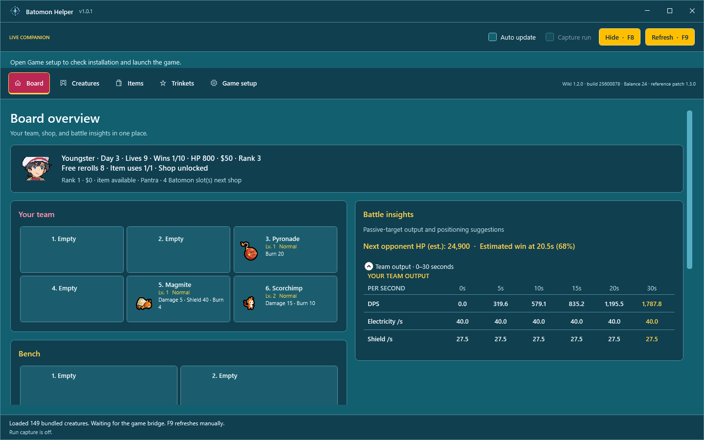
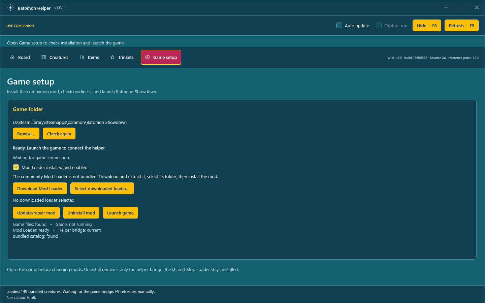

# Batomon Helper

A Windows companion for **Batomon Showdown**. View your live team, bench, shop, and battles alongside an offline creature, item, and trinket reference. A read-only companion mod exports state locally; the helper reads it every half second.



## Features

- Live stats, shop prices, trainer, rank, gold, lives, and run counters.
- Damage, healing, shielding, and status projections over 0–30 seconds, with team/bench position suggestions.
- Enemy lineups and the game's committed **WIN/LOSS** result.
- Searchable creatures, items, and trinkets, region filters, and shop odds.
- Optional run recording from the clean Day 1 opening, including game battle samples for simulator validation.
- Steam discovery, readiness checks, mod installation/removal, and game launch.

## Install and connect

1. Download the latest `BatomonHelper-Setup-<version>.exe` and matching `.sha256` file from [GitHub Releases](https://github.com/kamikadzexa/BatomonHelper/releases). Verify the installer checksum, then run the installer. It includes .NET, creates a Start Menu shortcut, and can add a desktop shortcut. Requires Windows 11 22H2 (build 22621) or newer, x64.
2. Open the helper. It opens **Game setup** automatically when the game or mod setup needs attention. Confirm the Steam folder or use **Browse…** to select the folder containing `batomon_showdown.exe` and `batomon_showdown.pck`.
3. Close the game. If **Mod Loader installed and enabled** is unchecked, choose **Download Mod Loader**, download and extract community Mod Loader 1.2.2, choose **Select downloaded loader…**, and select the extracted folder. Then choose **Install mod** to install the loader and Batomon Helper bridge. The loader is not bundled; its author does not permit redistribution.
4. Choose **Launch game**, then start or resume a run. The helper reads live state from the bridge mod.



The helper does not attach to the game process, capture screenshots, send gameplay inputs, or change saves. The bridge exports local JSON and makes no network requests. Reference browsing works with the game closed.

## Controls

| Control | Action |
| --- | --- |
| **Hide · F8** / global **F8** | Hide/show; F8 also restores a minimized helper |
| **Refresh · F9** / global **F9** | Refresh manually |
| **Auto update** | Read state every 500 ms |
| **Capture run** | Record shop changes plus game battle samples from the clean Day 1 opening |
| Window buttons / title-bar double-click | Minimize, maximize/restore, close |
| **Escape** | Restore a maximized window |

## Update and removal

Close the game and use **Game setup → Update/repair mod** or **Uninstall mod**. Other mods and configuration are preserved. Replaced files are backed up under the game's `.batomon-helper-backups` folder; failed changes roll back. Windows may request permission for protected game folders.

The helper checks the project's GitHub Releases on startup and can check on demand from **Game setup → Helper updates**. When a matching installer and SHA-256 checksum are published, choose **Install update**; optionally enable automatic installation. The installer is downloaded only after its checksum matches the release asset.

Bridge removal keeps the shared loader. Uninstalling the helper through Windows leaves game mods and per-user settings in place; remove the bridge first if desired.

## Troubleshooting and limits

- **Game not running:** use Game setup → Launch game. This is a normal disconnected state.
- **Missing loader/bridge:** install with the game closed.
- **Stale heartbeat:** repair the bridge and restart the game. The last board stays visible and is labelled disconnected.
- **Conflicting ModLoader:** resolve `override.cfg`; the helper preserves a different loader's entry.
- **Invalid/incompatible snapshot:** update helper and bridge together. Invalid boards are not applied.
- **Shortcut conflict:** another app owns F8/F9; use the on-screen controls.

WIN/LOSS comes from the game. Projections and position advice use a passive-target simulator and are estimates, not win probabilities. The offline wiki bundle targets **Balance 26**, Steam build **26078162**. Live stats and prices take precedence. See [bridge protocol and verified limits](docs/game-bridge.md).

## Development

```powershell
dotnet restore BatomonHelper.sln
dotnet run --project src/BatomonHelper.Overlay -c Release
dotnet test BatomonHelper.sln -c Release
.\Installer\Build-Installer.ps1
```

Needs .NET 10 SDK; installer creation also needs [Inno Setup 6](https://jrsoftware.org/isinfo.php). Pass `-CompilerPath` for a custom compiler location. Output includes installer, checksum, and [release notes](docs/release-1.0.4.md). Publish the installer and its `.sha256` file as identically versioned GitHub Release assets for in-app updating.

[Training Lab](docs/strategic-training.md) is separate and excluded from the installer. See [data/development details](docs/development.md) and [training](docs/training.md).

## License

Original helper and bridge code use [0BSD](LICENSE.txt): use, modify, copy, and redistribute for any purpose, including commercially, without an attribution requirement. Third-party material retains its own terms; see [notices and provenance](THIRD-PARTY-NOTICES.md). This is an unofficial community helper.
